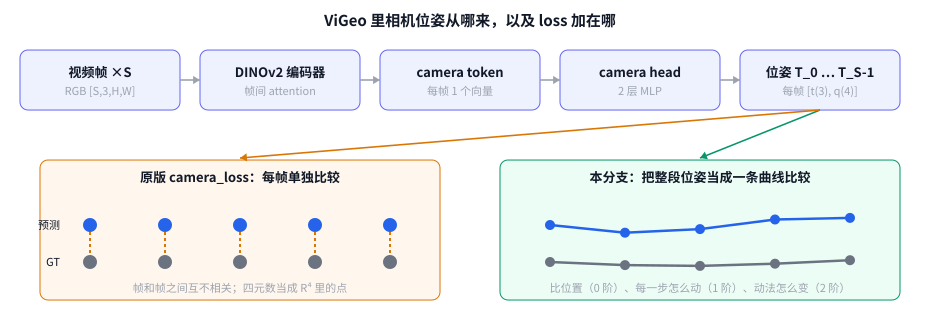

# 第 0 章 一页看懂：我们做了什么（不讲数学）

[← 目录](README.md) · [下一章：流形基础 →](01_manifold_basics.md)

## 0.1 ViGeo 在干什么

输入一段视频（S 帧），ViGeo 同时预测每一帧的：深度、点云、法向、置信度，以及**相机位姿**。
相机位姿 = 这一帧拍摄时，相机**在哪里**（位置 t，3 个数）和**朝哪儿看**（旋转 R，用四元数 q 表示，4 个数）。

把 S 帧的相机位置连起来，就是相机在空间里走过的**轨迹**。



## 0.2 原来的做法有什么问题

用大白话说有三个问题：

1. **一帧一帧单独比**。原 loss 对每一帧算"预测位姿和真值差多少"，然后求平均，**完全不看相邻帧之间的关系**。
   预测轨迹可以每帧都离真值很近，但前后乱跳。视频看起来就是相机在"抖"，重建出来的点云也会分层、发虚。
2. **旋转被当成普通的 4 个数**。原 loss 直接拿四元数的 4 个分量相减取绝对值。但旋转不是一条直线上的点，它所在的空间是"弯的"（第 1、2 章解释）。在弯曲的空间里直接相减，得到的不是真实误差。
3. **会突然跳变**。四元数 q 和 −q 表示同一个旋转，代码为了统一强制 q 的最后一个分量 ≥ 0。在某些角度下，预测只要偏一点，q 就被整个翻号，loss 从很小突然跳到很大（第 5 章图 1）。

论文标题叫 *Towards **Consistent** Video Geometry*，但训练目标里其实没有任何一项直接约束"一致性"。

## 0.3 我们的做法

**把一段视频的相机位姿看成一条曲线**，和真值曲线在三个层次上比较：

| 层次 | 比什么 | 生活类比 | 新 loss 名字 |
|---|---|---|---|
| 0 阶 | 每帧的位置和朝向 | 每个时刻车停在哪 | `geodesic_camera_loss` |
| 1 阶 | 相邻两帧之间**怎么动**的 | 每一秒车开了多远、转了多少弯 | `relative_motion_loss` |
| 2 阶 | 这种"动法"**怎么变化** | 车是平稳行驶，还是一脚油门一脚刹车 | `curve_accel_loss` |

旋转部分全部用"弯曲空间里的正确距离"（测地距离）来算，而不是直接相减。

**关键点**：我们比较的是"预测曲线 vs 真值曲线"，**不是**强行要求轨迹平滑。原因是训练数据有 30% 的帧序是被故意打乱的，真值轨迹自己也不平滑（第 5 章图 3）。

## 0.4 改了哪些文件

| 文件 | 类型 | 内容 |
|---|---|---|
| `src/loss/riemannian.py` | 新增 | 三个 loss + 几个几何小函数，约 140 行 |
| `src/loss/video_depth_loss.py` | 修改，+20 行 | 注册三个新 loss 名，加一个 `elif` 分支调用它们 |
| `configs/video_depth/vigeo_stage1_224x224_riemannian.py` | 新增 | 消融用配置：继承 stage1，只换 loss |
| `docs/riemannian/` | 新增 | 本教程 |

**默认不启用**：不在配置里写新 loss 的名字，训练行为就和原版完全一样。

## 0.5 怎么开关

在任意配置文件的 `loss_cfg.losses` 里加上名字和权重：

```python
loss_cfg = dict(
    losses=dict(
        scale_invariant_pointmap_loss=1.0,
        geodesic_camera_loss=1.0,  # 替代原来的 camera_loss
        relative_motion_loss=1.0,  # 1 阶
        curve_accel_loss=0.5,      # 2 阶
        normal_loss=1.0,
        ray_loss=1.0,
    )
)
```

现成的例子见 `configs/video_depth/vigeo_stage1_224x224_riemannian.py`。

## 0.6 现在的状态

- ✅ 代码写完，接入了训练 loss
- ✅ 用纯 Python 小实验验证了设计思路（第 5 章）
- ⚠️ **还没在 torch 上跑过**：作者本地没有 GPU，也没装 torch。第一次跑之前，先在 CPU 上用随机位姿做一次 forward/backward。
- ⬜ 消融实验待跑（第 6 章）

[← 目录](README.md) · [下一章：流形基础 →](01_manifold_basics.md)
