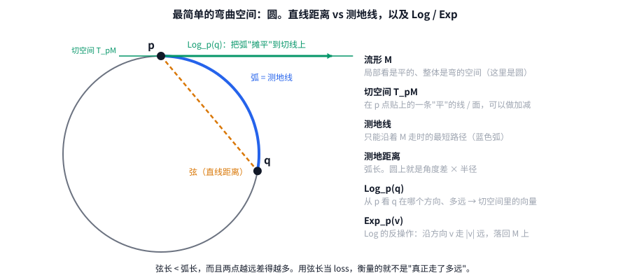

# 第 1 章 黎曼几何最小必需集

[← 上一章](00_overview.md) · [目录](README.md) · [下一章：旋转与李群 →](02_rotations_lie_groups.md)

> 本章目标：搞懂 6 个词：**流形、切空间、黎曼度量、测地线、测地距离、Log / Exp**。
> 本项目用到的黎曼几何就是这些，不需要曲率张量、联络系数之类的东西。

---

## 1.1 一个直觉：从北京飞到纽约

在平面地图上，北京到纽约画一条直线；但飞机实际走的是**向北绕过北极附近**的大圆航线。
原因很简单：地球表面是**弯的**，飞机只能贴着地表飞。在弯曲的表面上，"最短的路"不是我们以为的直线。

如果你硬要算"北京到纽约的直线距离"，那会是一条**穿过地心**的隧道。这个数字没有错，但它不是飞机要飞的距离。

**本项目的核心观察**：相机的"旋转"也活在一个弯曲的空间里，而原 loss 算的恰恰是那条"穿地心的隧道"。

---

## 1.2 流形（manifold）：局部是平的、整体是弯的

**流形**就是这样一种空间：你站在任意一点、只看身边很小一块时，它和普通的平面（或 3D 空间）没区别；但从整体看它是弯的、甚至是绕回来的。

| 例子 | 维度 | 局部像什么 | 整体特征 |
|---|---|---|---|
| 圆 S¹ | 1 | 一小段直线 | 走一圈回到原点 |
| 地球表面 S² | 2 | 一小块平面（所以古人以为地是平的） | 弯曲、有限、无边界 |
| **所有 3D 旋转 SO(3)** | 3 | 3D 空间的一小块 | 弯曲，转 360° 回到原样 |

最后一行是本项目的主角，第 2 章细讲。这一章先用**圆**来建立直觉，因为它能画在纸上。

---

## 1.3 切空间（tangent space）：在一点上贴一张"平的纸"

在流形上一点 p，可以贴上一张和它相切的平面（对圆来说是一条切线），叫 **p 点的切空间**，记作 $T_pM$。

切空间为什么重要？因为**流形上不能做加减法，但切空间里可以**。

- 地球表面上两个城市不能"相减"。北京 − 纽约 = ？没有意义。
- 但站在北京，"往东北方向走 100 公里"是一个**向量**，可以加减、可以缩放、可以求长度。这个向量就住在北京的切空间里。

所以几何学的基本套路是：**把弯曲空间上的问题，搬到切空间里，用线性代数解决**。我们的 loss 也是这么做的。

---

## 1.4 黎曼度量（Riemannian metric）：切空间里怎么量长度

有了切空间，还需要规定切空间里的向量**多长**、两个向量**夹角多大**，也就是在每个切空间上定义一个内积。
**黎曼度量** = 在流形的每一点上都选定一个内积，而且随着点的移动光滑变化。

- 对圆和球面，直接沿用外面 3D 空间的普通内积就行（"继承"来的度量）。
- 对旋转空间，第 2 章会看到它有一个"最自然"的度量：**旋转角度**本身。

**有了度量，才能谈"距离"和"最短路径"**。"黎曼几何"这个名字说的就是：带了度量的流形上的几何。

---

## 1.5 测地线与测地距离：弯曲空间里的"直线"和"距离"

- **测地线（geodesic）**：只能贴着流形走时的最短路径。在球面上是大圆弧，在圆上就是圆弧本身。
- **测地距离**：测地线的长度。圆上 = 两点的角度差 × 半径。

图里两种距离的区别：

| | 怎么算 | 意义 |
|---|---|---|
| **弦长**（橙色虚线） | 把两点当成外部空间里的点，直接相减求长度 | "穿隧道"的距离，**原 loss 算的是这个** |
| **弧长**（蓝色） | 沿着圆走过的长度 | 真实距离，**新 loss 算的是这个** |

### 一个具体数字

单位圆上，两点夹角为 θ：
- 弧长 = θ
- 弦长 = 2·sin(θ/2)

| θ | 弧长 | 弦长 | 弦长 / 弧长 |
|---|---|---|---|
| 10° | 0.175 | 0.174 | 99.9% |
| 90° | 1.571 | 1.414 | 90% |
| 170° | 2.967 | 1.993 | 67% |

**结论**：误差小时两者差不多；**误差越大，弦长越低估真实误差**，梯度也随之变弱，而这时恰恰最需要强梯度把预测拉回来。

---

## 1.6 Log 和 Exp：在流形和切空间之间来回

这是本项目代码里**最常用的两个操作**。

- **Log_p(q)**（对数映射）："站在 p 看 q，q 在哪个方向、有多远？" 把从 p 到 q 的测地线"摊平"到 p 的切空间上，得到一个向量。
  - 方向 = 从 p 出发去 q 的方向
  - 长度 = p 到 q 的**测地距离**
- **Exp_p(v)**（指数映射）：Log 的反操作。"从 p 出发，沿方向 v 走 |v| 那么远，落在哪？"

在圆上：Log_p(q) 就是"从 p 逆时针转多少角度到 q"（带正负号的一个数），Exp 就是"转这么多角度"。

**为什么叫 exp / log？** 对旋转来说，Exp 恰好就是矩阵指数函数 `expm`，Log 就是矩阵对数。第 2 章会看到。

### 两个最重要的性质

1. **测地距离 = Log 的长度**：$d(p, q) = \lVert \mathrm{Log}_p(q) \rVert$
   → 代码里 `so3_geodesic_angle` 就是这么算的。
2. **Log 把"差"变成了可以相减的向量**：要比较"从 p₁ 到 q₁ 的运动"和"从 p₂ 到 q₂ 的运动"，先把两段运动都 Log 成向量，再在同一个切空间里相减。
   → 这是第 3 章"速度""加速度"的基础。

---

## 1.7 本章小结

| 概念 | 一句话 | 在本项目里对应 |
|---|---|---|
| 流形 | 局部平、整体弯的空间 | 所有可能的相机朝向 SO(3) |
| 切空间 | 在一点贴的"平纸"，可以做线性代数 | 3 维向量空间，存放"转动"的轴角向量 |
| 黎曼度量 | 切空间里怎么量长度 | 旋转角度 |
| 测地距离 | 贴着流形走的最短距离 | 两个朝向之间相差的角度 |
| Log | 流形上的两点 → 切空间里的一个向量 | `so3_log` |
| Exp | 切空间里的向量 → 流形上的一点 | （本分支未直接用到，第 6 章的扩展方向会用） |

**带走一句话**：在弯曲空间里，不要直接相减；先用 Log 把差搬到切空间，再算长度或做加减。

[← 上一章](00_overview.md) · [目录](README.md) · [下一章：旋转与李群 →](02_rotations_lie_groups.md)
