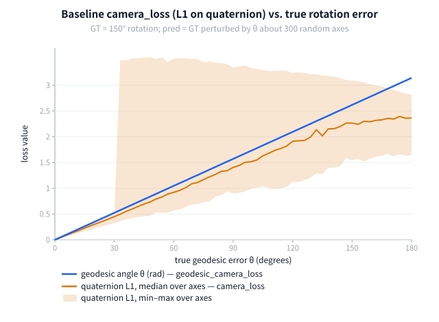
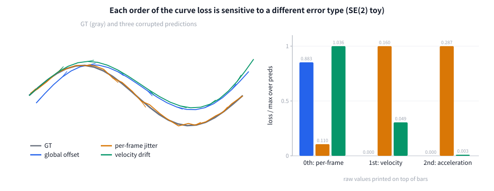
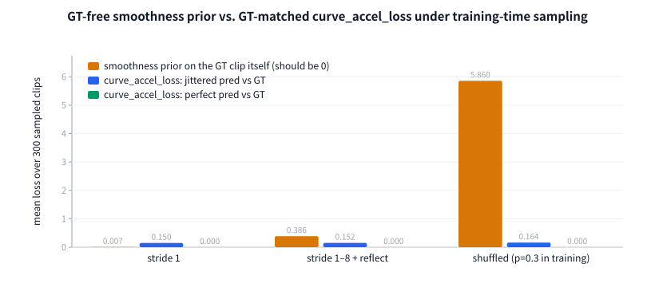

# 02 图解

所有图由 [`figures/make_figures.py`](figures/make_figures.py) 生成，只用 Python 标准库，不需要 torch/numpy/GPU：

```bash
python docs/riemannian/figures/make_figures.py
```

脚本会同时打印每张图背后的数值（下文表格里的数字就来自这些输出）。随机种子固定，结果可复现。
图 2、图 3 用的是 **SE(2) 平面玩具**：公式结构与 `src/loss/riemannian.py` 里的 SE(3) 版本一一对应，只是降到 2D 方便画图。

---

## 图 1：四元数 L1 vs 测地距离



**设定**：GT 是一个 150° 的旋转；预测 = GT 再沿 300 个随机轴各转 θ 度。分别计算原版 `camera_loss` 的旋转项（标准化后四元数的 L1）和真实测地角。

**怎么读**：
- 蓝线是理想情况：损失 = 真实误差。
- 橙色带是同一个 θ 下、不同转轴对应的 L1 取值范围。即使误差很小，带也有宽度，说明 **L1 的大小与转轴有关**。
- **θ ≈ 30° 处有一个跳变**：GT 的 w = cos(75°) ≈ 0.26，误差超过 180° − 150° = 30° 后，某些方向上预测四元数的 w 变成负数，被 `standardize_quaternion` 翻成 `−q`，L1 直接跳到约 2–3.5。这时梯度方向是错的。

**结论**：只要 clip 中某帧相对首帧转了很多（转身、环绕），原版损失在这些帧上就会不连续。`geodesic_camera_loss` 没有这个问题。

---

## 图 2：每一阶看见不同的误差



**设定**：一条平滑 GT 轨迹（24 帧，灰色），以及三种人为制造的预测：

| 预测 | 制造方式 | 0 阶 | 1 阶 | 2 阶 |
|---|---|---|---|---|
| global offset（蓝） | 整条轨迹刚体变换 6° + 平移 | 0.883 | **0.000** | **0.000** |
| per-frame jitter（橙） | 每帧独立加噪声 | 0.110 | 0.160 | **0.287** |
| velocity drift（绿） | 每步速度 ×1.06，并加 0.6° 偏航 | 1.036 | 0.049 | 0.003 |

（右图把每组柱子按组内最大值归一化，柱顶是原始数值。）

**怎么读**：
- 0 阶区分不出"整体偏了一下"和"漂移"，而且对抖动最不敏感，这正是逐帧位姿损失的盲区。
- 1 阶对 gauge 免疫，对漂移给出恒定的信号。
- 2 阶几乎只对抖动有反应。视频几何的"不一致 / 闪烁"在相机上就表现为这种误差。

---

## 图 3：训练采样下，平滑先验会惩罚 GT 本身



**设定**：复刻 `BaseDataset.sample_sequence` 的三种采样方式（每种 300 个长度为 24 的 clip），比较：
- 橙：GT-free 平滑先验 `mean‖a_i‖`，**直接作用在 GT 上**（理想值是 0）；
- 蓝：本分支的 `curve_accel_loss`，pred = GT + 同等程度的抖动；
- 绿：同一损失，pred = GT（完美预测）。

| 采样方式 | 平滑先验(GT) | 匹配损失(抖动) | 匹配损失(完美) |
|---|---|---|---|
| stride 1 | 0.007 | 0.150 | 0 |
| stride 1–8 + 反向 | 0.386 | 0.152 | 0 |
| 打乱（训练中 p=0.3） | **5.860** | 0.164 | 0 |

**结论**：在 ViGeo 的真实采样下，平滑先验对 GT 本身的惩罚比对真正抖动的惩罚还大（0.386、5.860 都大于 0.15），会和其他监督打架。匹配式损失在三种采样下都稳定，完美预测时恰好为 0。所以本分支只用匹配式损失，也不需要改数据管线。

---

## 交互页

[`interactive.html`](interactive.html)：直接用浏览器打开（离线、无依赖）。可以拖动"整体偏移 / 抖动 / 漂移"三个滑块，切换采样方式，实时观察 0/1/2 阶损失和平滑先验的变化。适合组会时现场讲解。
