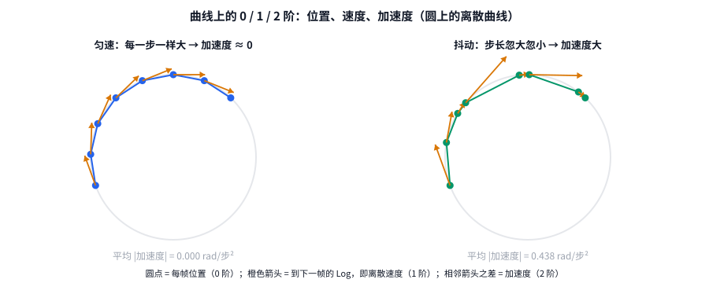

# 第 3 章 弯曲空间里的曲线：速度与加速度

[← 上一章](02_rotations_lie_groups.md) · [目录](README.md) · [下一章：ViGeo 与新 loss →](04_vigeo_and_our_losses.md)

> 本章目标：理解"把相机轨迹当成曲线"到底是什么意思，以及 1 阶（速度）、2 阶（加速度）在弯曲空间里怎么定义。
> **本项目的 novelty 就在这一章。**

---

## 3.1 先在平直空间里热身

一个点沿直线运动，第 i 帧在位置 $x_i$（一个普通数）。

| 阶 | 离散定义 | 含义 |
|---|---|---|
| 0 阶 位置 | $x_i$ | 在哪 |
| 1 阶 速度 | $v_i = x_{i+1} - x_i$ | 这一步走了多远 |
| 2 阶 加速度 | $a_i = v_{i+1} - v_i$ | 步子是不是忽大忽小 |

例子：
- 匀速 `0, 1, 2, 3, 4` → 速度 `1, 1, 1, 1` → 加速度 `0, 0, 0`
- 抖动 `0, 1.2, 1.9, 3.1, 4` → 速度 `1.2, 0.7, 1.2, 0.9` → 加速度 `−0.5, 0.5, −0.3`

两条轨迹每一帧的位置都很接近（0 阶误差小），但第二条的加速度明显不为 0。**"抖"就是 2 阶的东西**，只看 0 阶是看不出来的。

---

## 3.2 搬到弯曲空间：速度 = 相邻两帧之间的 Log

在 SE(3) 上，位置 $T_i$ 是一个 4×4 矩阵，不能直接相减（第 2 章）。替代方法是第 1 章的 Log：

$$\xi_i = \mathrm{Log}(T_i^{-1} T_{i+1}) = (\,\omega_i,\ v_i\,) = \big(\,\mathrm{Log}(R_i^\top R_{i+1}),\ R_i^\top(t_{i+1} - t_i)\,\big)$$

- $\omega_i$（3 维）：这一步转了多少（轴角）
- $v_i$（3 维）：这一步走了多远（在相机自己的坐标系里）

$\xi_i$ 叫 **body velocity**（体坐标系速度）：从相机自己的视角描述"这一步我怎么动的"，就像司机说"往前开了 10 米，同时右转了 5°"。



上图在圆上演示：圆点是每帧位置，橙色箭头是到下一帧的 Log，也就是离散速度。左边箭头一样长（匀速），右边忽长忽短（抖动）。

---

## 3.3 加速度：两个速度能直接相减吗？

直觉上 $a_i = \xi_{i+1} - \xi_i$。但这里有一个微妙的问题：

> $\xi_i$ 住在 $T_i$ 的切空间里，$\xi_{i+1}$ 住在 $T_{i+1}$ 的切空间里，是两张**不同的纸**。不同纸上的向量，能直接相减吗？

### 一般情况：不能直接减

还是飞机的例子：从北京沿大圆飞往纽约，飞机**一直在直飞、从不转弯**。但如果你每隔一小时看一次指南针，会发现航向在不断变化（起飞时朝东北，后来朝东，最后朝东南）。

天真地把相邻时刻的"航向向量"直接相减，会得出"飞机一直在转弯"的错误结论。原因是不同地点的"东北"不是同一个方向，球面是弯的。
正确的做法是先把一个向量**平行移动**到另一个点，再相减。这样算出的加速度叫**协变加速度**（covariant acceleration），飞机直飞时它恰好为 0。

### 李群上的捷径：body frame 已经帮我们对齐了

我们的 $\xi_i$ 不是随便哪个坐标系下的向量，而是"搬回单位元之后"的（2.4 节的技巧，术语叫**左平凡化**）。所以所有 $\xi_i$ 都住在**同一个**空间 ℝ⁶ 里，可以直接相减。

剩下的问题是：直接相减得到的，是不是**真正的**协变加速度？

> **选读：数学上的回答**
>
> 对李群上的左不变度量，把协变加速度用左平凡化写出来是（Euler–Arnold 方程）：
> $$\nabla_{\dot\gamma}\dot\gamma \;\longleftrightarrow\; \dot\xi - \mathrm{ad}^\dagger_\xi\, \xi$$
> 其中 $\mathrm{ad}^\dagger$ 是 $\mathrm{ad}$ 关于该度量的伴随。
> 旋转部分用的是**双不变度量**（2.4 节），此时 $\mathrm{ad}^\dagger_\xi = -\mathrm{ad}_\xi$，修正项变成 $\mathrm{ad}_\xi \xi = [\xi, \xi] = 0$（任何向量和自己的李括号都是 0）。
> 所以**旋转部分的协变加速度就是 $\dot\xi$**，离散化后就是 $\xi_{i+1} - \xi_i$。平移部分在 body frame 里用平坦度量处理，这是一个近似。

**结论**：

$$a_i = \xi_{i+1} - \xi_i$$

对旋转部分是**精确的**离散协变加速度，对平移部分是合理的近似。代码就是这么写的：

```python
# src/loss/riemannian.py :: curve_accel_loss
omega_pred, v_pred = relative_twist(pose_pred)   # 预测轨迹的速度 ξ
omega_gt, v_gt = relative_twist(pose_gt)         # 真值轨迹的速度 ξ
acc_r = (omega_pred.diff(dim=0) - omega_gt.diff(dim=0)).norm(dim=-1)   # 旋转加速度之差
acc_t = (v_pred.diff(dim=0) - v_gt.diff(dim=0)).abs().sum(-1)          # 平移加速度之差
```

`.diff(dim=0)` 就是 $\xi_{i+1} - \xi_i$。

---

## 3.4 三阶各管什么

| 误差类型 | 0 阶 位置 | 1 阶 速度 | 2 阶 加速度 |
|---|---|---|---|
| 整条轨迹被整体挪了位置 | **大** | 0 | 0 |
| 每帧独立地抖 | 小 | 中 | **大** |
| 速度有系统偏差（越走越偏） | **大**，随时间累积 | **中**，恒定 | 很小 |

- 第一行的 0 是**严格**为 0：第 2 章证明了相对位姿对整体变换不变，速度和加速度又都由相对位姿算出。
- 第 5 章的图 2 用数值验证了这张表。

**直观总结**：0 阶管"在不在对的地方"，1 阶管"每一步走得对不对"（≈ VO 里的 RPE 指标），**2 阶管"走得稳不稳"**。视频几何的"一致性"主要体现在 1、2 阶。

---

## 3.5 为什么是"和真值比"，而不是"要求平滑"

最直接的想法是：既然抖动对应大加速度，那就直接惩罚 $\sum \lVert a_i \rVert$，让预测轨迹平滑。**这不行**，原因在 ViGeo 的训练数据怎么采样（`src/datasets/base_data.py::sample_sequence`）：

1. 帧之间的间隔是随机的，1 到 8 帧不等。
2. 走到视频末尾会**掉头**往回走。
3. **30% 的样本帧序被完全打乱**。

在这三种情况下，**真值轨迹自己就不平滑**，打乱帧序时尤其严重。如果要求平滑，loss 会和真值打架。

我们的做法是比较 $a_i^{\text{pred}}$ 和 $a_i^{\text{gt}}$：

$$\mathcal{L}_2 = \frac{1}{S-2}\sum_i \lVert a_i^{\text{pred}} - a_i^{\text{gt}} \rVert$$

预测和真值用的是**同一组帧、同一个顺序**，所以：
- 不管间隔多大、是否打乱，只要预测完全正确，loss 就是 0；
- **不需要知道帧的时间戳**，不用改数据管线。

第 5 章的图 3 用数值验证了这一点。

---

## 3.6 更高的视角：曲线空间里的距离（novelty 的表述方式）

把三个 loss 加权求和：

$$D(\gamma^{\text{pred}}, \gamma^{\text{gt}}) = \lambda_0 \sum_i d(T_i^{\text{pred}}, T_i^{\text{gt}}) + \lambda_1 \sum_i d(\xi_i^{\text{pred}}, \xi_i^{\text{gt}}) + \lambda_2 \sum_i \lVert a_i^{\text{pred}} - a_i^{\text{gt}} \rVert$$

可以把它理解为：在"SE(3) 上所有曲线组成的空间"里定义了一个**距离**，同时考虑位置、速度、加速度。
在数学上这类距离叫 **Sobolev 型度量**（H² 表示用到了二阶导数）。

写论文时可以这样表述：
> 现有方法要么逐帧比较位姿（0 阶），要么比较相对位姿（1 阶）。我们把相机轨迹视为李群 SE(3) 上的曲线，引入基于协变加速度的二阶曲线度量。

往下还有一步可以走，叫**弹性度量**（elastic metric / SRVF）：让这个距离不受"曲线走得快慢"（参数化）的影响，从而正面处理随机帧间隔。第 6 章细说。

---

## 3.7 本章小结

| 概念 | 一句话 | 代码 |
|---|---|---|
| 离散曲线 | 一段视频的 S 个位姿 $T_0 \dots T_{S-1}$ | `pose[S, 4, 4]` |
| body velocity ξ | $\mathrm{Log}(T_i^{-1}T_{i+1})$，这一步怎么动 | `relative_twist` |
| 协变加速度 a | $\xi_{i+1} - \xi_i$，动法怎么变 | `.diff(dim=0)` |
| 平行移动 | 把切向量"不转弯地"搬到另一点 | 李群 + body frame 自动完成 |
| 匹配式 loss | 比较预测和真值的 ξ、a，而不是要求平滑 | `relative_motion_loss`、`curve_accel_loss` |

**带走一句话**：在李群上，用 body frame 表达速度之后，加速度就是相邻速度之差。2 阶 loss 比较的是预测和真值"抖的方式"是否一致。

[← 上一章](02_rotations_lie_groups.md) · [目录](README.md) · [下一章：ViGeo 与新 loss →](04_vigeo_and_our_losses.md)
