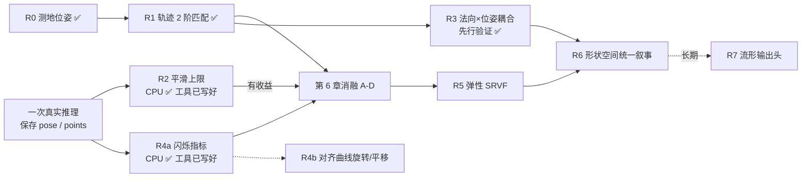

# 第 7 章 黎曼几何 novelty 全清单：实现方法、风险、优先级

[← 上一章](06_experiments_and_novelty.md) · [目录](README.md) · [术语表 →](glossary.md)

> 本章把 ViGeo 里**所有**能用上黎曼几何的地方列成清单，每条都写清：用到什么流形、ViGeo 现在怎么做、怎么实现、动手前怎么先验证、novelty 有多大、有哪些风险、优先级多少。
> 前置：第 1–3 章的概念（Log/Exp、测地距离、曲线的速度与加速度）。

> **✅ 已做 CPU 验证（2026-10-12）**：R0/R1、R2、R3、R4 都用纯 Python 在合成数据上验证过，详见 [`cpu_checks/RESULTS.md`](cpu_checks/RESULTS.md)。
> 主要变化：**R4 的尺度 loss 与现有点图 loss 冗余，已降为 ✗；它的估计器改作"深度闪烁"评估指标，升为 P1**。R3 通过了先行验证，成为首选扩展。下表已按验证结果更新。

---

## 7.1 总览

### 优先级定义

| 级别 | 含义 |
|---|---|
| **P0** | 主线，已实现 |
| **P1** | 下一步做：成本低、和主线直接相关、能尽快出结论 |
| **P2** | 加强 novelty：理论更深，需要改数据或模型 |
| **P3** | 长期 / 高风险：改动大或预期收益不明 |
| **✗** | 不建议：已经在用正确的几何，或者和主题无关 |

### 清单

| ID | 名称 | 流形 | 状态 | novelty | 成本 | 风险 | 优先级 |
|---|---|---|---|---|---|---|---|
| R0 | 逐帧测地位姿 loss | SO(3) | ✅ 已实现 | 低（已有） | — | 低 | **P0**（地基） |
| R1 | 相机轨迹 2 阶曲线匹配 | SE(3) | ✅ 已实现；数学已 CPU 验证 | **中高** | — | 中 | **P0**（主线） |
| R2 | 无训练的轨迹平滑上限实验 | SE(3) | ✅ 平滑器已写好，合成上限已测；等真实预测 | 低（只用于验证） | 极低，CPU | 低 | **P1** |
| R3 | 法向 × 位姿跨帧耦合 | S² × SO(3) | ✅ 先行验证通过（合成） | 中 | 中 | 中 | **P1，首选扩展** |
| R4a | 逐帧尺度闪烁**指标**（评估用） | ℝ⁺ ⊂ Sim(3) | ✅ 合成上估计误差 < 2% | 低–中 | 极低 | 低 | **P1（新）** |
| R4b | 逐帧对齐曲线的旋转 / 平移部分（loss） | Sim(3) | 未验证 | 中 | 中 | 中高 | **P2** |
| ~~R4~~ | ~~逐帧尺度 Karcher 离散度（loss）~~ | ℝ⁺ | ⚠️ 合成上**与现有 loss 冗余** | — | — | — | **✗** |
| R5 | 弹性（SRVF）轨迹度量 | SE(3) 曲线空间 | 未开始 | 中高 | 中 | 中 | **P2** |
| R6 | 视频 = 形状空间里的曲线（统一叙事） | Kendall 形状空间 | 未开始 | **高**（理论） | 低（写作）/ 高（完整实现） | 中（容易被认为过度包装） | **P2** |
| R7 | 流形结构的相机输出头 | SE(3)，Exp 积分 | 未开始 | 中 | 高（要重训） | 高 | **P3** |
| R8 | 完整 SE(3) 左不变度量 | SE(3) | 未开始 | 低 | 低 | 低（收益也小） | **P3** |
| R9 | 射线图用直线空间度量 | Plücker / S² | 未开始 | 低 | 低 | 高（可能无效） | **P3** |
| ✗1 | 深度用 log / ℝ⁺ 度量 | ℝ⁺ | — | 无 | — | — | ✗ |
| ✗2 | 置信度用 Fisher–Rao 度量 | 概率单纯形 | — | 无 | — | — | ✗ |
| ✗3 | 单帧法向测地 loss | S² | — | 无 | — | — | ✗ |
| ✗4 | 双曲 / 黎曼特征空间 | 双曲空间等 | — | 与主题无关 | — | — | ✗ |

### 推荐路线

**一句话路线**：拿到一次真实推理结果后，先用 R2（平滑上限）和 R4a（闪烁指标）在 CPU 上量化"一致性问题有多大" → 跑 R1 消融 → 用 R3 说明这套几何不只适用于相机 → 论文用 R6 把它们统一起来。

---

## 7.2 P0：已实现

### R0 逐帧测地位姿 loss

- **一句话**：旋转误差用真实角度 $\lVert \mathrm{Log}(R_{\text{pred}}^\top R_{\text{gt}}) \rVert$，代替四元数 L1。
- **代码**：`geodesic_camera_loss`（第 4.4 节）
- **novelty**：低。Hou et al. 2018 已经做过。它的作用是给后面的曲线 loss 打地基，同时修掉原 loss 的符号跳变（第 5 章图 1）。
- **风险**：几乎没有。唯一的问题是转角接近 180° 时梯度不稳，原 loss 也有同样的问题。

### R1 相机轨迹 2 阶曲线匹配

- **一句话**：把位姿序列当成 SE(3) 上的曲线，匹配预测和真值的体速度 ξ（1 阶）和协变加速度 a（2 阶）。
- **代码**：`relative_motion_loss`、`curve_accel_loss`（第 4.4 节）
- **novelty**：中高。1 阶（RPE 类监督）已有；2 阶协变加速度匹配在 feed-forward 视频几何模型里没搜到。
- **风险**：

| 风险 | 可能性 | 后果 | 应对 |
|---|---|---|---|
| ATE 不变，审稿人觉得没用 | 高 | 故事不成立 | 指标报 RPE、抖动、chunk 边界跳变；故事讲"一致性" |
| 2 阶信号太弱，被其他 loss 淹没 | 中 | 消融 D ≈ C | 调大 `curve_accel_loss` 权重；先看 R2 的上限 |
| 和点图 loss 冲突，深度变差 | 低 | 不能用 | 降权重；只在 stage1 之后 fine-tune |
| 代码 bug（没跑过） | 中 | 浪费 GPU | 先跑 `smoke_test.py` |
| 别人已经做过 | 低–中 | novelty 降级 | 投稿前系统查文献（第 6.1 节） |

---

## 7.3 P1：下一步

### R2 无训练的轨迹平滑上限实验（先验证，再花 GPU）

- **一句话**：拿到模型已有的预测轨迹，在 SE(3) 上做测地样条平滑，看 RPE 和抖动最多能改善多少。
- **为什么排第一**：**不需要训练**，平滑本身纯 CPU 就能跑。它回答一个关键问题："如果模型学会了二阶约束，最多能好多少？" 上限很小的话，R1 的消融就不值得跑。
- **实现方法**：
  1. 在 benchmark 分支跑一次推理，把每个序列的 `pose_pred` 存成 `.npy`。这一步需要 GPU，但只跑一次。
  2. 写一个纯 CPU 脚本，在 SE(3) 上求解平滑问题：
     $$\min_{T_0..T_{S-1}} \sum_i d(T_i, T_i^{\text{pred}})^2 + \lambda \sum_i \lVert \xi_{i+1} - \xi_i \rVert^2$$
     用李群上的 Gauss–Newton 迭代：每一步在切空间里解一个线性最小二乘，再用 Exp 更新。几十行 numpy 就够。
  3. 对比平滑前后的 ATE、RPE、抖动指标，扫一遍 λ。
- **已实现**：`docs/riemannian/cpu_checks/check_r2_smoothing.py::smooth_se3`（纯 Python）。合成数据上的结果：轨迹平滑时 RPE 降 82–93%，**急转弯时平滑有害**（见 [RESULTS](cpu_checks/RESULTS.md#r2无训练平滑的上限check_r2_smoothingpy)）。
- **novelty**：低，它只是验证工具。如果效果很好，也可以作为一个即插即用的后处理写进论文。
- **风险**：

| 风险 | 应对 |
|---|---|
| 平滑会抹掉真实的急转 | λ 要扫；分开报告有急转和没有急转的序列 |
| 后处理有效 ≠ 训练 loss 有效 | 只当作上限参考，不当结论 |

### R3 法向 × 位姿跨帧耦合（S² × SO(3)）

- **一句话**：同一个表面点在第 i、j 帧的法向，应该刚好相差两帧之间的相对旋转：$n_j \approx R_j^\top R_i\, n_i$。
- **现状**：`normal_map_loss` 只做单帧监督，并且只用于有法向真值的合成数据集。法向头和相机头之间**没有任何约束**。
- **实现方法**（改 `src/loss/video_depth_loss.py`，新函数放在 `src/loss/riemannian.py`）：
  1. **找对应点**（用真值，不反传梯度）：对第 i 帧的像素 u，用真值深度和内参反投影到 3D，用真值位姿变到第 j 帧并投影，得到 u'。
  2. **遮挡 / 动态物体过滤**：投影深度和第 j 帧真值深度在 u' 处的相对误差 < τ（比如 5%），才算有效对应点。
  3. **在 S² 上比较**：
     $$\mathcal{L} = \mathrm{mean}\ \angle\big(R_j^\top R_i\, n_i(u),\ n_j(u')\big)$$
     $n_j(u')$ 用 `grid_sample` 双线性采样后重新归一化。角度用 `atan2(|a×b|, a·b)`，避免 `acos` 的梯度爆炸（第 2.5 节）。
  4. 两个变体：
     - **R3a**：R 用**真值**相对旋转，只约束法向的时间一致性，梯度只进法向头。
     - **R3b**：R 用**预测**相对旋转，让法向头和相机头互相约束，梯度进两个头。
  5. 帧对只取相邻帧 (i, i+1)，帧序打乱时也成立，因为任意两帧都可以配对。
- **适用数据**：只需要真值深度和位姿，**不需要法向真值**，所以可以扩展到真实数据集。
- **先行验证**（✅ 合成数据已通过，见 [RESULTS](cpu_checks/RESULTS.md#r3法向--位姿跨帧耦合check_r3_normal_posepy)：真值上中位数 8e-16°；对位姿误差的响应斜率约 0.78；**必须用 90% 截尾均值**才能去掉边缘和小面积动态物体的残差）：在真值上算一遍（真值法向 + 真值位姿），这个 loss 应该接近 0。如果不接近 0，说明对应点或法向坐标系约定有错（ViGeo 的法向是朝内的、在相机坐标系下）。
- **novelty**：中。多视角法向一致性在 MVS / 神经表面重建里有人做过，在 feed-forward 视频几何模型里没见过。R3b 的"用法向反过来约束位姿"更新一些。
- **风险**：

| 风险 | 可能性 | 应对 |
|---|---|---|
| 动态物体（pointodyssey、bedlam、dynamic_replica、spring 等）对应点错误 | 高 | 深度一致性过滤；或先排除动态数据集 |
| 真实数据集深度噪声大，对应点不准 | 中 | 先只在合成数据集上开；τ 设严一点 |
| R3b 中法向误差反过来拉坏位姿 | 中 | 先做 R3a；R3b 对位姿那一路降权或 stop-grad |
| 投影 + 采样的显存开销 | 低 | 只用相邻帧对；在 1/2 或 1/4 分辨率上算 |
| 重复了 `normal_loss`（`edge_loss`）的作用 | 低 | `edge_loss` 是单帧局部几何，R3 是跨帧的，两者正交 |

### R4 逐帧对齐曲线 + Karcher 离散度（Sim(3)）

> **CPU 验证结论**（[详情](cpu_checks/RESULTS.md#r4逐帧对齐曲线是否冗余check_r4_redundancypy)）：
> - **尺度部分作为 loss 冗余**：现有点图 loss 对每帧尺度的梯度方向在 ≥94% 的情况下正确，已经在纠正闪烁 → 不做。
> - **尺度部分作为指标很好用**：现有 loss 的数值几乎看不出闪烁（10% 噪声下，2% 闪烁只让 loss 变化 2%），而 R4 的估计器在所有情况下误差 < 2% → 拆成 **R4a 闪烁指标（P1）**。
> - 旋转 / 平移部分未验证 → **R4b（P2）**。
>
> 下面是原始方案，保留作参考。

- **一句话**：对每一帧单独求一个相似变换 $g_i = (s_i, R_i, t_i) \in \mathrm{Sim}(3)$，把预测点云对齐到真值点云。**时间一致的预测，这些 $g_i$ 应该都相同**。所以惩罚 $\{g_i\}$ 在 Sim(3) 上的"离散程度"。
- **为什么有意思**：
  - 尺度部分 $s_i$ 随时间的变化，正是**视频深度闪烁**的定量描述，直接对应论文的 "consistent"。
  - 惩罚的是一组点到它们 **Karcher 均值**（黎曼流形上的平均）的距离，**和帧序无关**，打乱帧序也没问题。
  - chunk / online 推理时，chunk 之间的尺度漂移也落在这个框架里。
- **实现方法**：
  1. 每帧在有效像素上做加权 Umeyama 对齐：一次 3×3 SVD，求出 $(s_i, R_i, t_i)$。输入是已有的 `points_pred_i_norm` 和 `points_gt_i_norm`，两者都在各自帧的相机坐标系下，像素一一对应。
  2. Karcher 均值：尺度在 log 空间取平均，$\bar{s} = \exp(\mathrm{mean}\log s_i)$；旋转用 1–3 步迭代 $\bar R \leftarrow \bar R\,\mathrm{Exp}(\mathrm{mean}\ \mathrm{Log}(\bar R^\top R_i))$。
  3. loss：$\sum_i \big[(\log s_i - \log\bar s)^2 + \lVert \mathrm{Log}(\bar R^\top R_i) \rVert^2 + \lambda \lVert t_i - \bar t \rVert^2\big]$
  4. **最小版本**：只做尺度部分，不用 SVD，直接用现有的 `compute_pointmap_scale` 逐帧算 $s_i$。风险最小，可以最先做。
  5. 可选：在模型输出里加上 `segment_lengths`（训练时 chunk 的切分方式），对跨越 chunk 边界的帧对加大权重。
- **先行验证**（**必须先做**）：在已有的预测上算一遍 $\{s_i\}$ 的离散度。如果已经很小，说明现有的 `scale_invariant_pointmap_loss` 已经在隐式约束它（这个 loss 对整个 clip 共用一个尺度），R4 就是冗余的，应该放弃。
- **novelty**：中。SLAM 里有尺度漂移感知的 Sim(3) 优化；"对齐曲线的 Karcher 离散度"作为 feed-forward 训练 loss 没见过。
- **风险**：

| 风险 | 可能性 | 应对 |
|---|---|---|
| **和现有点图 loss 冗余** | **中高** | 先行验证；不冗余再做 |
| SVD 在退化场景（平面、点太少）梯度不稳 | 中 | 先只做尺度版；SVD 版对奇异值接近的样本跳过 |
| 稀疏的真实深度（如 LiDAR）对齐不准 | 中 | 最少有效像素数阈值 |
| 对静态相机 + 动态物体的场景意义不明确 | 低 | 只用静态区域（如有 mask） |

---

## 7.4 P2：加强 novelty

### R5 弹性（SRVF）轨迹度量

- **一句话**：让轨迹距离**对"走得快慢"不敏感**，正面处理训练时的随机帧间隔，而不是像 R1 那样绕开它。
- **背景**：R1 比较的是"同一组帧上的速度"。如果预测轨迹形状完全对、只是节奏快慢不同，R1 也会惩罚。弹性度量（Srivastava 等的 SRVF；Lie 群版本见 Celledoni、Eslitzbichler、Schmeding）只看形状。
- **实现方法**：
  1. **改数据**：`BaseDataset.sample_sequence` 现在只返回帧序列。改为同时返回帧号 `seq_ids`，经过 pipeline 放进 `img_metas`。所有 dataset 共用这个函数，改动集中在一处，但要检查 collate 和各个 augmentation 是否保留这个字段。
  2. 用帧号算真实时间间隔 Δt，得到速度 $\dot\xi_i = \xi_i / \Delta t_i$。
  3. SRV 变换：$q_i = \dot\xi_i / \sqrt{\lVert \dot\xi_i \rVert}$，再对预测和真值的 q 序列算 L²。
  4. 帧序被打乱的样本（帧号不单调）跳过。
  5. 可选：用动态规划求最优重参数化（完整的弹性距离）。训练时太贵，可以只在评估时用。
- **novelty**：中高。SRVF 在形状分析里成熟，用作视频位姿的训练 loss 没见过。
- **风险**：

| 风险 | 可能性 | 应对 |
|---|---|---|
| 改数据管线引入 bug（20+ 个 dataset） | 中 | 只在 `base_data` 加字段，每个 dataset 跑一个样本检查 |
| 速度接近 0 时 $1/\sqrt{\lVert\dot\xi\rVert}$ 发散 | 高（静止相机常见） | 加 ε；或者对静止段跳过 |
| 相比 R1 的增益很小 | 中 | 只在 R1 有效之后再做 |
| 30% 打乱样本被跳过，信号变少 | 确定 | 可以接受 |

### R6 视频 = 形状空间里的曲线（统一叙事）

- **一句话**：每帧的点云去掉相似变换（位置、朝向、尺度）之后，是 **Kendall 形状空间**里的一个点；相机位姿是 SE(3) 里的一个点。**一段视频的全部几何 = 一条 (形状, 位姿) 曲线**。R1、R3、R4 都是这个框架的特例。
- **对应关系**：

| 本框架 | 现有 / 本分支的东西 |
|---|---|
| 形状空间中的点（0 阶） | `normalize_pred` + `scale_i` + `scale_invariant_pointmap_loss`：粗略地在比较形状 |
| 位姿曲线的速度、加速度 | R1 |
| 商掉的 Sim(3) 部分在时间上的变化 | R4 |
| 形状曲线的切向量与位姿运动的耦合 | R3（法向是形状的局部微分） |

- **实现方法**：主要是**写作**。在方法部分用这个框架组织 R1、R3、R4，给出统一的 loss 表达式。完整实现（跨帧点对应的形状测地线）代价很高，不建议做。
- **novelty**：高，但主要是理论叙事上的。
- **风险**：

| 风险 | 应对 |
|---|---|
| 审稿人认为"包装大于内容" | 必须有 R1 + R3 或 R4 的实验支撑；框架只当组织方式，不当贡献主体 |
| 跨帧没有点对应，严格意义上的形状曲线不好定义 | 明确说明：只在逐帧（像素对应）和相邻帧（R3 的投影对应）两个层面使用 |

---

## 7.5 P3：长期 / 高风险

### R7 流形结构的相机输出头

- **一句话**：camera head 不直接输出每帧位姿，而是输出相邻帧的运动 $\xi_i \in \mathfrak{se}(3)$，再用 $T_{i+1} = T_i\,\mathrm{Exp}(\xi_i)$ 积分。轨迹连续性由**结构本身**保证。
- **实现方法**：新增一个 relative head（输入可以是相邻两帧 camera token 的拼接）；保留原 head 输出 $T_0$ 或做全局校正；用 0 阶 + 1 阶 loss 共同训练。
- **风险**：

| 风险 | 说明 |
|---|---|
| 误差累积 | 长序列漂移，需要原 head 做全局锚定 |
| 和已发布 checkpoint 不兼容 | 需要从某个 stage 重新训练，GPU 成本高 |
| online / chunk 推理逻辑要改 | KV cache 之间要传递上一帧位姿 |
| 帧序打乱的训练样本 | 相邻帧可能相距很远，ξ 很大，需要跳过或单独处理 |

- **novelty**：中。VO 网络里常见，在 VGGT 类模型里少见。

### R8 完整 SE(3) 左不变度量

- **一句话**：现在用 SO(3)×ℝ³ 积度量（旋转、平移分开算）。改用耦合的 SE(3) 度量后，协变加速度要加上 Euler–Arnold 修正项 $-\mathrm{ad}^\dagger_\xi \xi$（第 3.3 节），它不再为 0。
- **实现方法**：在 `curve_accel_loss` 里显式计算 $\mathrm{ad}^\dagger$。这需要选定 se(3) 上的内积矩阵，有闭式表达。
- **风险**：低，但**预期收益也很小**。相邻帧运动很小，修正项是二阶小量。适合放在论文附录里提一句"更一般的情形"。

### R9 射线图用直线空间度量

- **一句话**：`ray_head` 输出每个像素一条 3D 射线 `[方向, 原点]`。方向在 S² 上（`get_world_rays` 里已经归一化），整条直线在 Plücker 直线空间里，但 `ray_loss` 对 6 维做的是 L1。
- **实现方法**：方向部分换成 S² 测地角；或者整体改用 Plücker 坐标 $(d, o \times d)$ 的直线距离。
- **风险**：**高**。`ray_head` 在推理时根本不用（`vigeo.py` 里的注释写明只是为了能加载 checkpoint）。它只作为辅助监督，改了也可能对最终输出没有影响。

---

## 7.6 ✗ 不建议做的方向（以及原因）

写下来是为了避免以后重复讨论。

| 方向 | 为什么不做 |
|---|---|
| **✗1 深度用 ℝ⁺ / log 度量** | ViGeo 的深度输出是 `exp(z)`，加上尺度不变 loss，**本身就是 log 度量**。再包装一遍没有新东西 |
| **✗2 置信度用 Fisher–Rao 度量** | 置信度用 BCE 训练，BCE 就是 KL 散度，已经是信息几何里的标准做法 |
| **✗3 单帧法向测地 loss** | `normal_map_loss` 已经用 `angle_between` 了，就是 S² 测地距离。跨帧才有新东西，见 R3 |
| **✗4 双曲 / 黎曼特征空间** | 改的是网络内部表示，和"几何估计"这个主题关系弱，审稿人会觉得是硬套 |

---

## 7.7 共性风险（所有方向都适用）

| 风险 | 说明 | 应对 |
|---|---|---|
| **novelty 未经系统验证** | 本章的判断只基于两次网络检索和作者的文献印象 | 投稿前做系统调研：VGGT 后续工作、视频深度/位姿、Lie 群曲线分析在视觉中的应用 |
| **没有 GPU** | 作者本地只能做理论、代码和 CPU 验证 | 每个方向都设计了 CPU 能做的"先行验证"；GPU 只用在最后的消融 |
| **代码未运行** | 当前分支的 loss 没在 torch 上跑过 | `smoke_test.py` |
| **故事和指标不匹配** | 几何约束通常改善一致性，而不是绝对精度 | 主打 RPE、抖动、深度闪烁、chunk 边界；ATE 和深度精度持平即可 |
| **权重调参成本** | 每加一项 loss 就多一个超参 | 每个方向先在 stage1 小分辨率上扫 2–3 个值 |

[← 上一章](06_experiments_and_novelty.md) · [目录](README.md) · [术语表 →](glossary.md)
